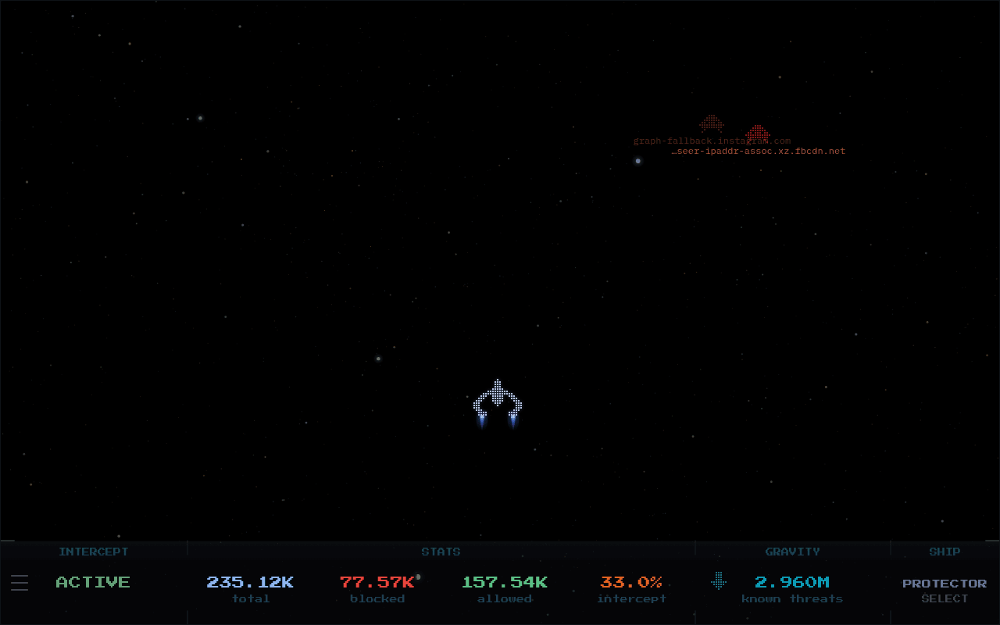
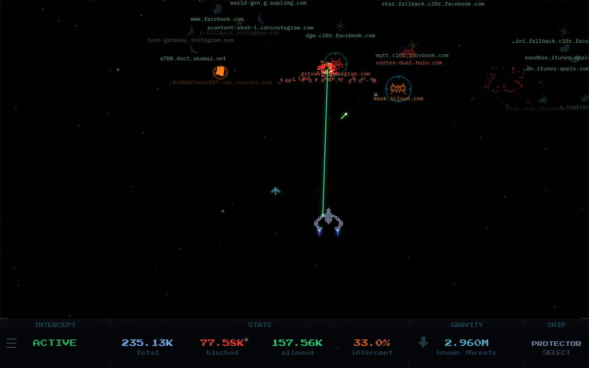
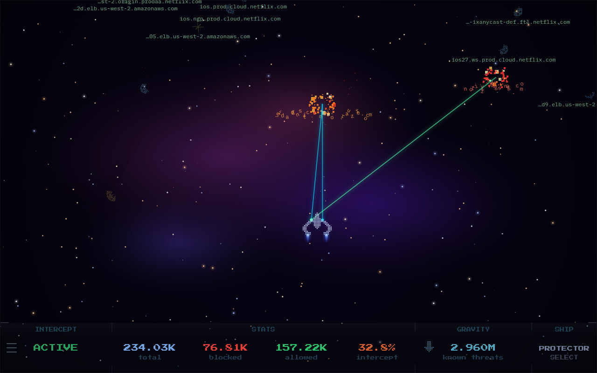
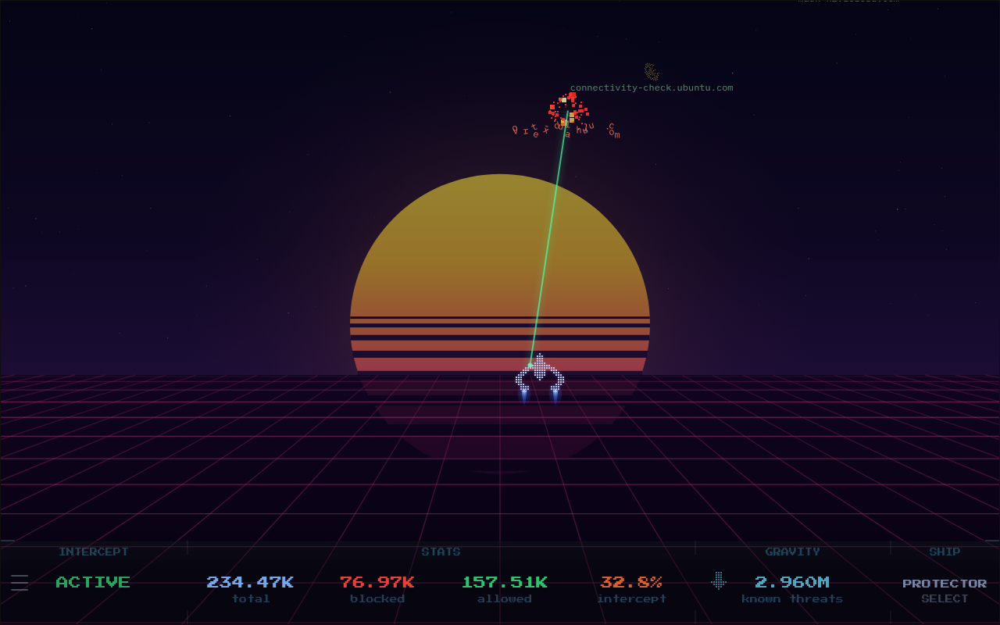
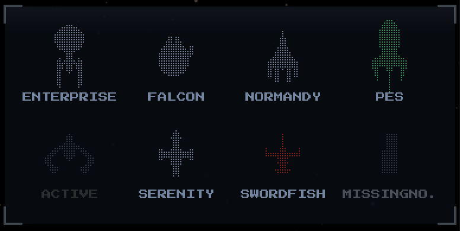
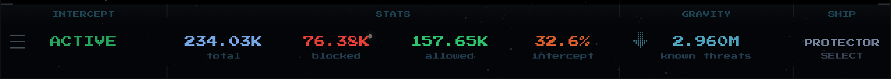

# ph-intercept

<a href="https://github.com/m00grin/ph-intercept/releases/latest"></a>
<a href="https://github.com/m00grin/ph-intercept/actions/workflows/publish.yml"></a>
<a href="https://github.com/m00grin/ph-intercept/actions/workflows/codeql.yml"></a>
<a href="https://www.bestpractices.dev/projects/16750"></a>

A Pi-hole, AdGuard Home, and Technitium DNS dashboard that runs as a standalone Docker container. Streams live DNS query events from your Pi-hole v6 API and renders them as pixel-art friendlies and enemies. Blocked queries are destroyed by the ship, allowed queries fly through. Toggle blocking, set timed blocks, trigger gravity updates, and switch ships from the HUD.

Designed to be dropped in alongside an existing Pi-hole v6 setup with no extra dependencies. Two instances can run side by side in [local 2-player split-screen](#local-2-player-mode).

Try the [live demo](https://ph-intercept.com/demo/) in your browser first, no install needed.



| Starfield | Nebula | Outrun |
|:---:|:---:|:---:|
|  |  |  |

---

> **AdGuard Home user?** See the [AdGuard setup guide](adguard/README.md).
>
> **Technitium DNS user?** See the [Technitium setup guide](technitium/README.md).

## Quick Start

**1.** Get your Pi-hole **app password** (not your web login password): from the Pi-hole admin panel, go to **Settings → Web interface / API → Configure app password**.

- **CLI users:** Create a `.env` file in the same directory as your `compose.yaml`:

  ```env
  PIHOLE_PASSWORD=your_pihole_app_password
  ```

- **Portainer users:** Skip the `.env` file. Add `PIHOLE_PASSWORD` as an environment variable directly in the Portainer stack config.

**2.** Create a `compose.yaml` (copy the example below or grab [`compose.yaml`](compose.yaml) from the repo) and update `PIHOLE_URL` to your Pi-hole's address:

```yaml
services:
  ph-intercept:
    image: ghcr.io/m00grin/ph-intercept:latest
    hostname: ph-intercept
    container_name: ph-intercept
    restart: unless-stopped
    deploy:
      resources:
        limits:
          memory: 128m
          cpus: "1"
          pids: 20

    environment:
      # REQUIRED: Pi-hole v6 API endpoint
      # Example: "http://192.168.1.2:80/api"
      PIHOLE_URL: "http://CHANGE.ME:PORT/api"

      # CLI users: Create a .env file in the same dir as this compose file with:
      #  PIHOLE_PASSWORD=your_pihole_app_password
      # Portainer Web users: Add the environment variable: PIHOLE_PASSWORD=your_pihole_app_password
      PIHOLE_PASSWORD: ${PIHOLE_PASSWORD}

      # Optional: where ESC navigates to (like your homelab dashboard or homepage)
      # Accepts http://, https://, protocol-relative (//), relative paths, and custom app schemes
      # Leave blank ("") to disable ESC entirely
      RETURN_URL: ""

      # Background. These set the DEFAULT; each user can also switch the background live
      # from the in-app settings menu, and their choice is remembered per-browser.
      # Style: starfield | nebula | outrun | dark
      BG_MODE: starfield

      # Sky region shown for the starfield:
      #   summer_triangle | orion | scorpius | southern_cross
      SKY_PRESET: summer_triangle

      # Optional custom background image: a URL, or /bg/your-filename.jpg (mounted volume).
      # When set, it becomes the default and enables the in-app "CUSTOM" option so it can be
      # picked any time. Leave blank to disable it (CUSTOM shows greyed out in the menu).
      BG_IMAGE: ""

      # SSL certificate verification. Set to "false" if Pi-hole uses HTTPS
      #  with a self-signed certificate. Leave as "true" for HTTP or valid HTTPS.
      PIHOLE_VERIFY_SSL: "true"

      # Optional: comma-separated regex patterns. Matching domains spawn no ships. Case-insensitive.
      # PIHOLE_IGNORE_DOMAINS: .*\.local$,.*\.internal$

      # Optional: "true" makes the page view-only. The server refuses the blocking
      # toggle, filter update and 2-player mode switch; the HUD controls go inert.
      # READ_ONLY: "true"

      # Optional: "true" drops the client name/IP from every query on the server,
      # so it never reaches the browser. Also hides the in-app CLIENT toggle.
      # HIDE_CLIENT: "true"

      # Optional: comma-separated regex patterns matched against the client name or IP.
      # Queries from matching clients spawn no ships. Case-insensitive.
      # PIHOLE_IGNORE_CLIENTS: ^uptime-kuma$,^192\.168\.1\.99$

      # Optional: "true" replaces every domain with an opaque per-start token on the
      # server. Repeat queries still group; domain labels and the DOMAIN toggle go away.
      # HIDE_DOMAIN: "true"

      # 2-player local mode: set the URL (and password if the second Pi-hole has one)
      # to enable a second Pi-hole ship on the right half
      # PIHOLE2_URL: "http://192.168.1.3:8053/api"
      # PIHOLE2_PASSWORD: ${PIHOLE2_PASSWORD}
      # PIHOLE2_VERIFY_SSL: "true"

    volumes:
      # Portainer Web users: This will resolve to /data/compose/<stack-id>/bg/
      - ./bg:/app/static/bg
      # Persists 2-player mode state across container restarts
      - data:/app/data

    cap_drop:
      - ALL

    security_opt:
      - "no-new-privileges:true"

    read_only: true

    logging:
      driver: "json-file"
      options:
        max-size: "10m"
        max-file: "3"

    ports:
      # Host port : container port. Change the left side if 4653 is taken
      - "4653:4653"

    # Optional: point DNS at your Pi-hole (if used for DNS resolution) or resolver directly (like Unbound)
    # dns:
    #   - your.dns.dockernet.ip

    # Optional: only needed if you use static IPs on a custom Docker network
    # Uncomment both networks blocks if you need this
    # networks:
    #   intercept_net:
    #     ipv4_address: this.container.dockernet.ip

# networks:
#   intercept_net:
#     external: true

volumes:
  data:
```

**3.** Start the container:

```bash
docker compose up -d
```

Open `http://your-host:4653`.

---

## Image Tags

| Tag | What it is |
|-----|------------|
| `:latest` | Latest stable release. |
| `:X.Y.Z` | Pinned release (e.g. `1.5.8`). |
| `:develop` | GHCR only. Built automatically on every push to the `develop` branch. May be unstable. Good for trying out what I'm working on. |

---

## Other Ways to Get It

### Registries

GitHub is where the work happens and where every image is built. Each release is published, unchanged, to every registry below, so the digest is identical everywhere. Pull from whichever you prefer.

| Registry | Image | Notes |
|----------|-------|-------|
| GitHub (GHCR) | `ghcr.io/m00grin/ph-intercept` | Home. Also carries `:develop`. |
| [Docker Hub](https://hub.docker.com/r/m00grin/ph-intercept) | `docker.io/m00grin/ph-intercept` | Release tags. |
| [Codeberg](https://codeberg.org/m00grin/-/packages/container/ph-intercept) | `codeberg.org/m00grin/ph-intercept` | `:latest` and the last few releases. |
| [GitLab](https://gitlab.com/m00grin/ph-intercept/container_registry) | `registry.gitlab.com/m00grin/ph-intercept` | Release tags. |

Use the tags from [Image Tags](#image-tags).

### Build from source

Prefer to build it yourself? Clone a release tag, check that I signed it, and build. The image builds natively for whatever architecture your machine is, with no buildx needed.

```bash
tag=$(git ls-remote --tags --refs --sort=-v:refname https://github.com/m00grin/ph-intercept.git 'v*' | head -n1 | sed 's|.*refs/tags/||')
git clone --depth 1 --branch "$tag" https://github.com/m00grin/ph-intercept.git
cd ph-intercept

echo '* ssh-ed25519 AAAAC3NzaC1lZDI1NTE5AAAAIMdnYVfo4t2Ag1LkmaQ5nKiN66g23hyHHfWRlsaV93tZ' > /tmp/ph-intercept-signers
git -c gpg.ssh.allowedSignersFile=/tmp/ph-intercept-signers tag -v "$tag"

docker build -t ph-intercept .
```

`tag -v` should report a good signature with key `SHA256:34Xm5zcAM5p/n6QZD3nJ7p/bbzp21Mh3/e8sHkGk+co`. The first line picks the newest release. To build a specific one, set `tag` yourself, for example `tag=v1.5.8`.

Then use the [Quick Start](#quick-start) compose file, replacing its `image:` line with `image: ph-intercept`. Compose uses the image you just built, so there is nothing to pull. Then run `docker compose up -d`.

---

## Entities

Each DNS query spawns an entity. Tier scales with how many times that domain has queried while the entity is still on screen:

**Allowed queries:** friendly ships traveling across the screen. Cache-answered queries move faster than upstream-answered ones.


| Tier | Condition | Shape | Color |
|------|-----------|-------|-------|
| 1 | First query | Rounded shuttle · Delta wing · X-wing | Green · Blue · Lime |
| 2 | Queried again while on screen | Heavy transport | Cyan |
| 3+ | Three or more queries while on screen | Capital ship | Gold |

**Blocked queries:** enemies the ship targets and destroys. A domain blocked again while still on screen mutates its sprite to the next tier in place.


| Tier | Condition | Shape | Color |
|------|-----------|-------|-------|
| 1 | First block | Crab invader · Squid | Red |
| 2 | Blocked twice | Heavy drone | Orange |
| 3+ | Three or more | Boss | Purple |

Ship weapon color tracks tier: green for tier 1, cyan for tier 2, gold for tier 3+.

---

## The ship

The ship targets and destroys blocked entities autonomously. At five on-screen threats a support drone launches and flanks; at ten a second drone deploys. Drones are recalled when the threat count drops.

Seven ships are selectable from the HUD, shown in an 8-slot 4×2 grid: **Protector** (NSEA Protector, default), **Falcon** (Millennium Falcon), **Swordfish** (Swordfish II), **Enterprise** (NCC-1701), **Serenity** (Firefly), **Normandy** (Mass Effect), and **PES** (Planet Express Ship). Switching ships triggers a warp-out/warp-in transition that pushes nearby entities aside.



---

## The HUD

A strip across the bottom, divided into four panels:

**INTERCEPT:** blocking status and toggle. Click to open a menu with timed-disable options (10 sec, 30 sec, 5 min) or a full disable. A countdown shows during a timed block; it survives navigation and syncs if blocking changes remotely.

**STATS:** total queries, blocked, allowed, and block percentage. Updated live.

**GRAVITY:** gravity list size. The arrow triggers a list update and confirms when done.

**SHIPS:** active ship name. Click to open the ship selector.



A hamburger button at the left edge of the HUD opens the **Settings** panel, which includes:

- **Friendlies**, **Client**, **Domain**: show or hide friendly entities, the requesting client label, and the domain label
- **CRT filter**: a scanline overlay
- **Auto-hide**: slides the HUD away until you hover it
- **Background**: switch style and sky region live
- **Pi-hole**: link to the Pi-hole admin panel

Display settings are saved to `localStorage` and restored on next load.

---

## The background

Four modes are available via `BG_MODE`:

**`starfield` (default):** Renders a real section of the night sky from an accurate star catalog (~12,200 stars to magnitude 6.8, color-coded by spectral type). Positions use equatorial coordinates; what you see is where the stars actually are. The sky region is set by `SKY_PRESET`.


Star data is from the **HYG Database** by David Nash ([astronexus.com](https://astronexus.com)), combining Hipparcos (ESA) and the Yale Bright Star Catalogue, and is licensed under [CC BY-SA 4.0](https://creativecommons.org/licenses/by-sa/4.0/).

**Planets:** Mars, Jupiter, Saturn (with ring), and the Moon are computed from real orbital elements and appear at their actual sky positions, updated hourly.

**Transients:** occasional satellite passes and meteors, including the ISS.

**`nebula`:** A procedurally generated nebula. Overlapping color lobes with value noise, dust lanes, and a synthetic star layer. Fully GPU-rendered, no catalog data.

**`outrun`:** A retro synthwave scene. A banded sun setting on the horizon over a scrolling neon perspective grid, with a starry sky. Pairs especially well with the CRT filter.

**`dark`:** Plain black background. No canvas rendering overhead.

**`BG_IMAGE`:** A custom image (URL or a `/bg/your-file.jpg` mounted into the container).

The env vars set the **default** background. Each user can also switch it live from the in-app settings menu (**Background**), including sky presets and, when `BG_IMAGE` is set, a **CUSTOM** option. That choice is remembered per browser and never changes anyone else's default.

**Portainer:** drop image files into `/data/compose/<stack-id>/bg/` on the Portainer host (where the `./bg` bind mount resolves).

---

## Configuration

All configuration is via environment variables in `compose.yaml`.

> **Upgrading?** Pull the latest `compose.yaml` to see all current options. Anything you don't set uses its default, so an older compose keeps working.

### Required

| Variable | Description |
|----------|-------------|
| `PIHOLE_PASSWORD` | Pi-hole app password. CLI: set in a `.env` file. Portainer: add as an environment variable in the stack. Get it from **Settings → Web interface / API → Configure app password**. |
| `PIHOLE_URL` | Pi-hole v6 API base URL, e.g. `http://192.168.1.x:8053/api` |

### Optional

| Variable | Default | Description |
|----------|---------|-------------|
| `RETURN_URL` | `""` | URL that ESC navigates to. Accepts `http://`, `https://`, protocol-relative (`//`), relative paths, and custom app schemes. Leave blank to disable ESC. |
| `BG_MODE` | `starfield` | Default background: `starfield` · `nebula` · `outrun` · `dark`. Switchable live in-app. |
| `SKY_PRESET` | `summer_triangle` | Default sky region: `summer_triangle` · `orion` · `scorpius` · `southern_cross`. Switchable live in-app. |
| `BG_IMAGE` | `""` | Custom image URL or `/bg/filename.jpg`. When set, it's the default and enables the in-app `CUSTOM` option; blank leaves `CUSTOM` disabled. |
| `READ_ONLY` | `false` | Set to `true` for a wall display or a page others can open: the server refuses every request that changes something (blocking toggle, filter update, 2-player mode) with HTTP 403, and the HUD leaves those controls inert. Status and stats stay visible. |
| `HIDE_CLIENT` | `false` | Set to `true` to drop the client name or IP from every query before it is sent to the browser. The in-app `CLIENT` toggle is hidden. |
| `HIDE_DOMAIN` | `false` | Set to `true` to replace every domain with an opaque token before it is sent to the browser (HMAC-SHA256 with a random key generated at each start, so tokens can't be looked up from a list of common domains). Repeat queries still group into tiers; domain labels, the letter fragments on a kill and the in-app `DOMAIN` toggle are left out. |
| `PIHOLE_VERIFY_SSL` | `true` | Set to `false` if Pi-hole uses HTTPS with a self-signed certificate. |
| `PIHOLE_IGNORE_DOMAINS` | _(unset)_ | Comma-separated regex patterns. Domains that match spawn no ships. Case-insensitive; escape literal dots (`\.local$`). Example: `.*\.local$,.*\.internal$` |
| `PIHOLE_IGNORE_CLIENTS` | _(unset)_ | Comma-separated regex patterns, matched against the client name and IP. Queries from matching clients spawn no ships. Case-insensitive; escape literal dots (`^192\.168\.1\.99$`). Example: `^uptime-kuma$,^10\.0\.0\.5$` |
| `PIHOLE2_URL` | _(unset)_ | Second Pi-hole v6 API base URL. Setting a valid URL activates local 2-player split-screen mode. See below. |
| `PIHOLE2_PASSWORD` | `""` | App password for the second Pi-hole. Omit if it has none. |
| `PIHOLE2_VERIFY_SSL` | `true` | Set to `false` if the second Pi-hole uses HTTPS with a self-signed certificate. |

---

## Local 2-Player Mode

Two DNS instances can run side by side in split-screen. Player 1's ship occupies the left half of the canvas, Player 2's ship the right. Each instance streams its own events, stats, and controls.

Add the second Pi-hole to your `compose.yaml` environment block:

```yaml
PIHOLE2_URL: "http://192.168.1.3:8053/api"
PIHOLE2_PASSWORD: ${PIHOLE2_PASSWORD}
```

And add the password to your `.env` file:

```env
PIHOLE2_PASSWORD=your_second_pihole_password
```

`PIHOLE2_PASSWORD` can be omitted if the second Pi-hole has no app password set. Setting a valid `PIHOLE2_URL` is all that is required to make the mode available; turn it on from the in-game 2-player panel. On/off state is saved to the `data` volume, so it survives container restarts.

> **AdGuard Home?** The second instance mirrors your primary provider, so an AdGuard setup pairs with a second AdGuard Home via `ADGUARD2_URL` / `ADGUARD2_USERNAME` / `ADGUARD2_PASSWORD`. See the [AdGuard 2-player setup](adguard/README.md#local-2-player-mode).
>
> **Technitium DNS?** Pairs with a second Technitium via `TECHNITIUM2_URL` and `TECHNITIUM2_TOKEN` (or user + password). See the [Technitium 2-player setup](technitium/README.md#local-2-player-mode).

---

## Requirements

- Pi-hole v6 (v5 is not compatible)
- Docker with Compose
- Network route from the container to your Pi-hole
- **Architecture:** `linux/amd64` · `linux/arm64` · `linux/arm/v7` · `linux/arm/v6` · `linux/386` · `linux/riscv64` · `linux/ppc64le`

The container listens on port 4653. The compose file includes an optional static IP block for existing Docker networks.

Curious what everyone runs it on? I'm asking in a [quick poll](https://github.com/m00grin/ph-intercept/discussions/52) instead of collecting any data.

---

## Troubleshooting

If something's off, check the logs first:

```bash
docker logs ph-intercept 2>&1 | grep -v '^INFO:'
```

On a healthy setup that prints nothing. Otherwise ph-intercept logs one line when a problem starts, and one line when it clears:

| Log line | What to check |
|----------|---------------|
| `Pi-hole: could not reach http://... Check PIHOLE_URL` | The URL and port, and that the container can reach your Pi-hole over the network. |
| `Pi-hole: unexpected HTTP 404 reply from .../auth. Check PIHOLE_URL points at the Pi-hole v6 API (ends in /api)` | `PIHOLE_URL` must end in `/api`, not `/admin`. |
| `Pi-hole: login rejected (password incorrect). Check PIHOLE_PASSWORD` | Use an app password from **Settings → Web interface / API → Configure app password**. |
| `Pi-hole: login refused by rate limiting (...), retrying` | Pi-hole throttles logins after a few quick attempts. It clears on its own within a few seconds. |
| `PROVIDER='...' is not recognised ...` | `PROVIDER` must be `pihole`, `adguard`, or `technitium` (or leave it out for Pi-hole). |

In 2-player mode the second Pi-hole logs the same lines as `Pi-hole 2`, pointing at the `PIHOLE2_*` variables.

---

## Privacy

ph-intercept only talks to your own Pi-hole instance(s). It never phones home, has no analytics, and collects nothing. Your display settings (ship, background, toggles) are saved in your browser's local storage and never leave it. Requests from other websites to the blocking controls are refused, so a page you visit can't toggle your DNS server through ph-intercept.

**Shared screens:** on a wall display or a page other people can open, `READ_ONLY` stops anyone from changing your DNS server, and `HIDE_CLIENT` and `HIDE_DOMAIN` keep client names and domains out of the browser. See [Optional settings](#optional).

---

## Testing

I may have gone a little overboard.

ph-intercept is developed against a suite of about 700 tests that I run locally before every release. The suite lives on my machine, not in this repository. CI builds the images and scans them (CodeQL and Trivy). The tests cover these layers:

- **DNS providers:** async unit tests for the Pi-hole, AdGuard Home, and Technitium clients: every auth path, session handling, query classification, the broadcast queue, and the live query pollers
- **API and config:** every route, security headers, cache-control rules, input validation, environment parsing, and the `READ_ONLY`, `HIDE_CLIENT`, and `HIDE_DOMAIN` modes
- **2-player mode:** routes, state persistence, and the races between two instances
- **Browser:** Playwright tests in Chromium, Firefox, and WebKit for page load, canvas sizing, SSE connection and reconnect, settings persistence, blocked storage, sprite recovery, and bfcache reentry
- **Devices:** emulated device profiles and viewports, including Raspberry Pi touchscreens, Fire tablets, iPads, Android tablets, HiDPI displays, 4K, ultrawides, and orientation changes
- **Pixels:** a canvas baseline that hashes rendered scenes, so a drawing regression can't hide behind passing behavior tests
- **Docs and listings:** checks that the READMEs, example composes, and the Unraid template stay in step
