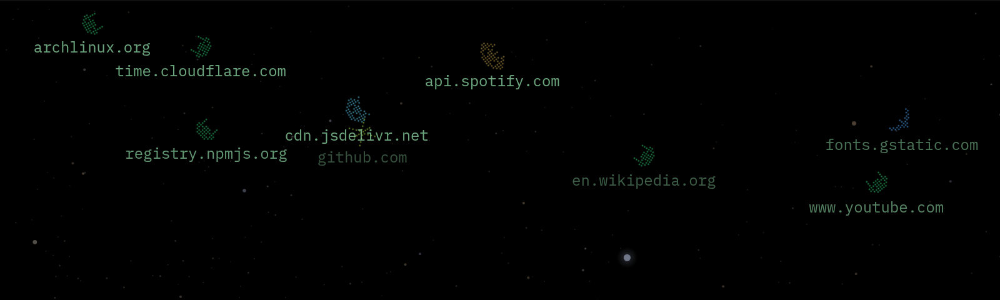
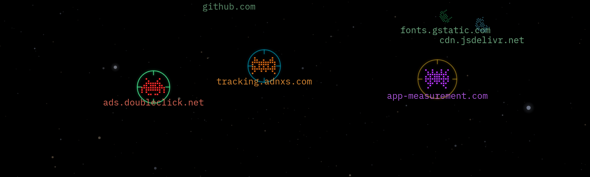

# ph-intercept

<a href="https://github.com/m00grin/ph-intercept/releases/latest"></a>
<a href="https://github.com/m00grin/ph-intercept/actions/workflows/publish.yml"></a>
<a href="https://github.com/m00grin/ph-intercept/actions/workflows/codeql.yml"></a>
<a href="https://www.bestpractices.dev/projects/16750"></a>

A Pi-hole, AdGuard Home, Technitium DNS, and Blocky visualizer and dashboard that runs as a standalone Docker container. Streams live DNS query events from your Pi-hole v6, AdGuard Home, Technitium DNS, or Blocky server and renders them as pixel-art friendlies and enemies. Blocked queries are destroyed by the ship, allowed queries fly through. Toggle blocking, set timed blocks, update block lists, and switch ships from the HUD.

Designed to be dropped in alongside an existing DNS setup with no extra dependencies. Two instances can run side by side in [local 2-player split-screen](#local-2-player-mode).

Try the [live demo](https://ph-intercept.com/demo/) in your browser first, no install needed.


| Starfield | Nebula | Outrun |
|:---:|:---:|:---:|
|  |  |  |

---

> **One compose for every ad-blocker.** Pi-hole, AdGuard Home, Technitium DNS, and Blocky all use the compose below. ph-intercept works out which one you run. A few servers need one extra step: see [Your ad-blocker](#your-ad-blocker).

## Quick Start

**1.** Have your ad-blocker's address and login ready (see [Your ad-blocker](#your-ad-blocker) for what each one needs):

- **Pi-hole:** an **app password** (not your web login password), from **Settings → Web interface / API → Configure app password**.
- **AdGuard Home:** your username and password.
- **Technitium DNS:** an API token (**Administration → Sessions → Create Token**), or your username and password.
- **Blocky:** no login. It needs its query log shared instead: see [Blocky setup](#blocky-setup).

- **CLI users:** Create a `.env` file in the same directory as your `compose.yaml`:

  ```env
  BLOCKER_PASSWORD=your_password
  ```

- **Portainer users:** Skip the `.env` file. Add `BLOCKER_PASSWORD` as an environment variable directly in the Portainer stack config.

**2.** Create a `compose.yaml` (copy the example below or grab [`compose.yaml`](compose.yaml) from the repo) and set `BLOCKER_URL` to the address you open in a browser to manage your ad-blocker. For AdGuard Home or Technitium, also uncomment `BLOCKER_USERNAME`:

```yaml
services:
  ph-intercept:
    image: ghcr.io/m00grin/ph-intercept:latest
    hostname: ph-intercept
    container_name: ph-intercept
    restart: unless-stopped
    deploy:
      resources:
        limits:
          memory: 128m
          cpus: "1"
          pids: 20

    environment:
      # REQUIRED: the address you open in a browser to manage your ad-blocker.
      # Works with Pi-hole v6, AdGuard Home, Technitium DNS, and Blocky; ph-intercept
      # detects which one it is. Example: "http://192.168.1.2"
      BLOCKER_URL: "http://CHANGE.ME"

      # Pi-hole: an app password. AdGuard Home or Technitium: your login password.
      # Blocky has no login: leave it out.
      # CLI users: Create a .env file in the same dir as this compose file with:
      #  BLOCKER_PASSWORD=your_password
      # Portainer Web users: Add the environment variable: BLOCKER_PASSWORD=your_password
      BLOCKER_PASSWORD: ${BLOCKER_PASSWORD}

      # AdGuard Home and Technitium only: your login username
      # BLOCKER_USERNAME: "admin"

      # Technitium only: an API token instead of a username and password
      # BLOCKER_TOKEN: ${BLOCKER_TOKEN}

      # Optional: where ESC navigates to (like your homelab dashboard or homepage)
      # Accepts http://, https://, protocol-relative (//), relative paths, and custom app schemes
      # Leave blank ("") to disable ESC entirely
      RETURN_URL: ""

      # Background. These set the DEFAULT; each user can also switch the background live
      # from the in-app settings menu, and their choice is remembered per-browser.
      # Style: starfield | nebula | outrun | dark
      BG_MODE: starfield

      # Sky region shown for the starfield:
      #   summer_triangle | orion | scorpius | southern_cross
      SKY_PRESET: summer_triangle

      # Optional custom background image: a URL, or /bg/your-filename.jpg (mounted volume).
      # When set, it becomes the default and enables the in-app "CUSTOM" option so it can be
      # picked any time. Leave blank to disable it (CUSTOM shows greyed out in the menu).
      BG_IMAGE: ""

      # SSL certificate verification. Set to "false" if your ad-blocker uses HTTPS
      #  with a self-signed certificate. Leave as "true" for HTTP or valid HTTPS.
      BLOCKER_VERIFY_SSL: "true"

      # Optional: comma-separated regex patterns. Matching domains spawn no ships. Case-insensitive.
      # IGNORE_DOMAINS: .*\.local$,.*\.internal$

      # Optional: "true" makes the page view-only. The server refuses the blocking
      # toggle, filter update and 2-player mode switch; the HUD controls go inert.
      # READ_ONLY: "true"

      # Optional: "true" drops the client name/IP from every query on the server,
      # so it never reaches the browser. Also hides the in-app CLIENT toggle.
      # HIDE_CLIENT: "true"

      # Optional: comma-separated regex patterns matched against the client name or IP.
      # Queries from matching clients spawn no ships. Case-insensitive.
      # IGNORE_CLIENTS: ^uptime-kuma$,^192\.168\.1\.99$

      # Optional: "true" replaces every domain with an opaque per-start token on the
      # server. Repeat queries still group; domain labels and the DOMAIN toggle go away.
      # HIDE_DOMAIN: "true"

      # Optional: how much goes in the container log: info (default), debug, warning, or error
      # LOG_LEVEL: info

      # 2-player local mode: a second ad-blocker, any of the four, for a second ship on
      # the right half. Same settings as above with BLOCKER2_.
      # BLOCKER2_URL: "http://192.168.1.3"
      # BLOCKER2_PASSWORD: ${BLOCKER2_PASSWORD}

    volumes:
      # Portainer Web users: This will resolve to /data/compose/<stack-id>/bg/
      - ./bg:/app/static/bg
      # Persists 2-player mode state across container restarts
      - data:/app/data
      # Blocky only: the folder Blocky writes its CSV query log to, read-only
      # - /path/to/blocky/logs:/blocky-logs:ro

    cap_drop:
      - ALL

    security_opt:
      - "no-new-privileges:true"

    read_only: true

    ports:
      # Host port : container port. Change the left side if 4653 is taken
      - "4653:4653"

    # Optional: point DNS at your Pi-hole (if used for DNS resolution) or resolver directly (like Unbound)
    # dns:
    #   - your.dns.dockernet.ip

    # Optional: only needed if you use static IPs on a custom Docker network
    # Uncomment both networks blocks if you need this
    # networks:
    #   intercept_net:
    #     ipv4_address: this.container.dockernet.ip

# networks:
#   intercept_net:
#     external: true

volumes:
  data:
```

**3.** Start the container:

```bash
docker compose up -d
```

Open `http://your-host:4653`.

---

## Image Tags

| Tag | What it is |
|-----|------------|
| `:latest` | Latest stable release. |
| `:X.Y.Z` | Pinned release (e.g. `1.5.8`). |
| `:develop` | GHCR only. Built automatically on every push to the `develop` branch. May be unstable. Good for trying out what I'm working on. |

---

## Other Ways to Get It

### Registries

GitHub is where the work happens and where every image is built. Each release is published, unchanged, to every registry below, so the digest is identical everywhere. Pull from whichever you prefer.

| Registry | Image | Notes |
|----------|-------|-------|
| GitHub (GHCR) | `ghcr.io/m00grin/ph-intercept` | Home. Also carries `:develop`. |
| [Docker Hub](https://hub.docker.com/r/m00grin/ph-intercept) | `docker.io/m00grin/ph-intercept` | Release tags. |
| [Codeberg](https://codeberg.org/m00grin/-/packages/container/ph-intercept) | `codeberg.org/m00grin/ph-intercept` | `:latest` and the last few releases. |
| [GitLab](https://gitlab.com/m00grin/ph-intercept/container_registry) | `registry.gitlab.com/m00grin/ph-intercept` | Release tags. |

Use the tags from [Image Tags](#image-tags).

### Build from source

Prefer to build it yourself? Clone a release tag, check that I signed it, and build. The image builds natively for whatever architecture your machine is, with no buildx needed.

```bash
tag=$(git ls-remote --tags --refs --sort=-v:refname https://github.com/m00grin/ph-intercept.git 'v*' | head -n1 | sed 's|.*refs/tags/||')
git clone --depth 1 --branch "$tag" https://github.com/m00grin/ph-intercept.git
cd ph-intercept

echo '* ssh-ed25519 AAAAC3NzaC1lZDI1NTE5AAAAIMdnYVfo4t2Ag1LkmaQ5nKiN66g23hyHHfWRlsaV93tZ' > /tmp/ph-intercept-signers
git -c gpg.ssh.allowedSignersFile=/tmp/ph-intercept-signers tag -v "$tag"

docker build -t ph-intercept .
```

`tag -v` should report a good signature with key `SHA256:34Xm5zcAM5p/n6QZD3nJ7p/bbzp21Mh3/e8sHkGk+co`. The first line picks the newest release. To build a specific one, set `tag` yourself, for example `tag=v1.5.8`.

Then use the [Quick Start](#quick-start) compose file, replacing its `image:` line with `image: ph-intercept`. Compose uses the image you just built, so there is nothing to pull. Then run `docker compose up -d`.

---

## Entities

Each DNS query spawns an entity. Tier scales with how many times that domain has queried while the entity is still on screen:

**Allowed queries:** friendly ships traveling across the screen. Cache-answered queries move faster than upstream-answered ones.



| Tier | Condition | Shape | Color |
|------|-----------|-------|-------|
| 1 | First query | Rounded shuttle · Delta wing · X-wing | Green · Blue · Lime |
| 2 | Queried again while on screen | Heavy transport | Cyan |
| 3+ | Three or more queries while on screen | Capital ship | Gold |

**Blocked queries:** enemies the ship targets and destroys. A domain blocked again while still on screen mutates its sprite to the next tier in place.



| Tier | Condition | Shape | Color |
|------|-----------|-------|-------|
| 1 | First block | Crab invader · Squid | Red |
| 2 | Blocked twice | Heavy drone | Orange |
| 3+ | Three or more | Boss | Purple |

Ship weapon color tracks tier: green for tier 1, cyan for tier 2, gold for tier 3+.

---

## The ship

The ship targets and destroys blocked entities autonomously. At five on-screen threats a support drone launches and flanks; at ten a second drone deploys. Drones are recalled when the threat count drops.

Seven ships are selectable from the HUD, shown in an 8-slot 4×2 grid: **Protector** (NSEA Protector, default), **Falcon** (Millennium Falcon), **Swordfish** (Swordfish II), **Enterprise** (NCC-1701), **Serenity** (Firefly), **Normandy** (Mass Effect), and **PES** (Planet Express Ship). Switching ships triggers a warp-out/warp-in transition that pushes nearby entities aside.


---

## The HUD

A strip across the bottom, divided into four panels:

**INTERCEPT:** blocking status and toggle. Click to open a menu with timed-disable options (10 sec, 30 sec, 5 min) or a full disable. A countdown shows during a timed block; it survives navigation and syncs if blocking changes remotely.

**STATS:** total queries, blocked, allowed, and block percentage. Updated live.

**Lists:** block list size, named the way your ad-blocker names it: GRAVITY (Pi-hole), BLOCKLIST (AdGuard Home), BLOCK LIST (Technitium), or DENYLIST (Blocky). The arrow triggers a list update and confirms when done.

**SHIPS:** active ship name. Click to open the ship selector.


A hamburger button at the left edge of the HUD opens the **Settings** panel, which includes:

- **Friendlies**, **Client**, **Domain**: show or hide friendly entities, the requesting client label, and the domain label
- **CRT filter**: a scanline overlay
- **Auto-hide**: slides the HUD away until you hover it
- **Background**: switch style and sky region live
- **Pi-hole** (or your ad-blocker's name): link to its admin panel

Display settings are saved to `localStorage` and restored on next load.

---

## The background

Four modes are available via `BG_MODE`:

**`starfield` (default):** Renders a real section of the night sky from an accurate star catalog (~12,200 stars to magnitude 6.8, color-coded by spectral type). Positions use equatorial coordinates; what you see is where the stars actually are. The sky region is set by `SKY_PRESET`.


Star data is from the **HYG Database** by David Nash ([astronexus.com](https://astronexus.com)), combining Hipparcos (ESA) and the Yale Bright Star Catalogue, and is licensed under [CC BY-SA 4.0](https://creativecommons.org/licenses/by-sa/4.0/).

**Planets:** Mars, Jupiter, Saturn (with ring), and the Moon are computed from real orbital elements and appear at their actual sky positions, updated hourly.

**Transients:** occasional satellite passes and meteors, including the ISS.

**`nebula`:** A procedurally generated nebula. Overlapping color lobes with value noise, dust lanes, and a synthetic star layer. Fully GPU-rendered, no catalog data.

**`outrun`:** A retro synthwave scene. A banded sun setting on the horizon over a scrolling neon perspective grid, with a starry sky. Pairs especially well with the CRT filter.

**`dark`:** Plain black background. No canvas rendering overhead.

**`BG_IMAGE`:** A custom image (URL or a `/bg/your-file.jpg` mounted into the container).

The env vars set the **default** background. Each user can also switch it live from the in-app settings menu (**Background**), including sky presets and, when `BG_IMAGE` is set, a **CUSTOM** option. That choice is remembered per browser and never changes anyone else's default.

**Portainer:** drop image files into `/data/compose/<stack-id>/bg/` on the Portainer host (where the `./bg` bind mount resolves).

---

## Configuration

All configuration is via environment variables in `compose.yaml`.

> **Upgrading?** Your compose keeps working as it is: every setting from earlier releases (`PIHOLE_URL`, `ADGUARD_PASSWORD`, `PROVIDER`, and the rest) is still read, and wins if both an old and a new name are set. The new names below are the simpler way to set up from scratch. [Older settings](#older-settings) maps one to the other.

### Required

| Variable | Description |
|----------|-------------|
| `BLOCKER_URL` | The address you open in a browser to manage your ad-blocker, e.g. `http://192.168.1.2`. A pasted `/admin` or `/api` on the end is fine. |
| `BLOCKER_PASSWORD` | Pi-hole: app password. AdGuard Home or Technitium: login password. Not used by Blocky. CLI: set in a `.env` file. Portainer: add as an environment variable in the stack. |

### Optional

| Variable | Default | Description |
|----------|---------|-------------|
| `BLOCKER_USERNAME` | `""` | AdGuard Home or Technitium login username. |
| `BLOCKER_TOKEN` | `""` | Technitium API token, instead of a username and password. |
| `BLOCKER_TYPE` | _(detected)_ | `pihole`, `adguard`, `technitium`, or `blocky`. Leave it out and ph-intercept identifies the server at startup. If set and the server turns out to be something else, ph-intercept says so and doesn't start that side. |
| `BLOCKER_VERIFY_SSL` | `true` | Set to `false` if your ad-blocker uses HTTPS with a self-signed certificate. |
| `BLOCKER_DASHBOARD` | _(derived)_ | Link for the settings menu. Defaults to the server's own web interface. |
| `RETURN_URL` | `""` | URL that ESC navigates to. Accepts `http://`, `https://`, protocol-relative (`//`), relative paths, and custom app schemes. Leave blank to disable ESC. |
| `BG_MODE` | `starfield` | Default background: `starfield` · `nebula` · `outrun` · `dark`. Switchable live in-app. |
| `SKY_PRESET` | `summer_triangle` | Default sky region: `summer_triangle` · `orion` · `scorpius` · `southern_cross`. Switchable live in-app. |
| `BG_IMAGE` | `""` | Custom image URL or `/bg/filename.jpg`. When set, it's the default and enables the in-app `CUSTOM` option; blank leaves `CUSTOM` disabled. |
| `READ_ONLY` | `false` | Set to `true` for a wall display or a page others can open: the server refuses every request that changes something (blocking toggle, filter update, 2-player mode) with HTTP 403, and the HUD leaves those controls inert. Status and stats stay visible. |
| `HIDE_CLIENT` | `false` | Set to `true` to drop the client name or IP from every query before it is sent to the browser. The in-app `CLIENT` toggle is hidden. |
| `HIDE_DOMAIN` | `false` | Set to `true` to replace every domain with an opaque token before it is sent to the browser (HMAC-SHA256 with a random key generated at each start, so tokens can't be looked up from a list of common domains). Repeat queries still group into tiers; domain labels, the letter fragments on a kill and the in-app `DOMAIN` toggle are left out. |
| `IGNORE_DOMAINS` | _(unset)_ | Comma-separated regex patterns. Domains that match spawn no ships, on both sides. Case-insensitive; escape literal dots (`\.local$`). Example: `.*\.local$,.*\.internal$` |
| `IGNORE_CLIENTS` | _(unset)_ | Comma-separated regex patterns, matched against the client name and IP. Queries from matching clients spawn no ships, on both sides. Case-insensitive; escape literal dots (`^192\.168\.1\.99$`). Example: `^uptime-kuma$,^10\.0\.0\.5$` |
| `BLOCKER_IGNORE_DOMAINS`, `BLOCKER_IGNORE_CLIENTS` | _(unset)_ | Same, for player 1's side only. `BLOCKER2_IGNORE_*` for player 2's. |
| `BLOCKER_PASSWORD_FILE` | _(unset)_ | Read the password from a file, for Docker secrets (`/run/secrets/...`). Also `BLOCKER_TOKEN_FILE` and `BLOCKER_USERNAME_FILE`. |
| `LOG_LEVEL` | `info` | How much goes in the container log. `info`: the startup banner, a line per player, and real events. `debug`: extra detail for troubleshooting. `warning`: problems only. `error`: errors only. |

At startup the log shows a banner with the version, then a line per player: the ad-blocker it found, its address, where its settings came from, and anything it ignored. It never prints a password or token.

### Older settings

Each provider's own names still work, exactly as before. Use whichever you like; if both are set, the provider's own name wins.

| New | Pi-hole | AdGuard Home | Technitium | Blocky |
|-----|---------|--------------|------------|--------|
| `BLOCKER_URL` | `PIHOLE_URL` (ends in `/api`) | `ADGUARD_URL` (ends in `/control`) | `TECHNITIUM_URL` | `BLOCKY_URL` |
| `BLOCKER_USERNAME` | | `ADGUARD_USERNAME` | `TECHNITIUM_USER` | |
| `BLOCKER_PASSWORD` | `PIHOLE_PASSWORD` | `ADGUARD_PASSWORD` | `TECHNITIUM_PASSWORD` | |
| `BLOCKER_TOKEN` | | | `TECHNITIUM_TOKEN` | |
| `BLOCKER_VERIFY_SSL` | `PIHOLE_VERIFY_SSL` | `ADGUARD_VERIFY_SSL` | `TECHNITIUM_VERIFY_SSL` | `BLOCKY_VERIFY_SSL` |
| `BLOCKER_TYPE` | `PROVIDER` | `PROVIDER` | `PROVIDER` | `PROVIDER` |
| `BLOCKER_DASHBOARD` | | | | `BLOCKY_DASHBOARD` |

`BLOCKER2_*` maps to `PIHOLE2_*`, `ADGUARD2_*`, and so on. The per-provider ignore lists (`PIHOLE_IGNORE_DOMAINS` and the rest) still apply to any side running that provider, together with `IGNORE_*`. Settings only one server has keep that server's name: `TECHNITIUM_TOTP`, `TECHNITIUM_QUERY_LOG_APP`, `TECHNITIUM_QUERY_LOG_CLASS`, and `BLOCKY_LOG_DIR`.

---

## Your ad-blocker

| Server | `BLOCKER_URL` | Login | Also needed |
|--------|---------------|-------|-------------|
| Pi-hole v6 | Its web address, e.g. `http://192.168.1.2` | `BLOCKER_PASSWORD`: an app password | Nothing |
| AdGuard Home | Its web address, e.g. `http://192.168.1.2:3000` | `BLOCKER_USERNAME` and `BLOCKER_PASSWORD` | Nothing |
| Technitium DNS 13+ | Its web console, e.g. `http://192.168.1.2:5380` | `BLOCKER_TOKEN`, or `BLOCKER_USERNAME` and `BLOCKER_PASSWORD` | The **Query Logs (Sqlite)** app from Technitium's App Store |
| Blocky | Its HTTP port, e.g. `http://192.168.1.2:4000` | None | Its CSV query log, shared read-only, so the same machine: see below |

More on each: [AdGuard Home](adguard/README.md) · [Technitium DNS](technitium/README.md).

## Blocky setup

> **Same machine only, for now.** Blocky has no API for recent queries, so ph-intercept reads the CSV query log Blocky writes, through a read-only mount. That means ph-intercept has to run on the same machine as Blocky (or see Blocky's log folder over a network share). With Blocky on another machine, stats and the blocking controls still work, but no ships appear, and the log says the query log folder isn't mounted.

Blocking control and stats use Blocky's REST API, which has no login.

**1.** In Blocky's `config.yml`, turn on the CSV log and stats (and keep its HTTP port on), then restart Blocky:

```yaml
ports:
  http: 4000
queryLog:
  type: csv          # not csv-client
  target: /logs
statistics:
  enable: true       # optional: query counts in the HUD
```

**2.** Give Blocky a host folder for that log, for example `- ./blocky-logs:/logs` in Blocky's compose.

**3.** In the ph-intercept [compose](#quick-start), set `BLOCKER_URL` to Blocky's HTTP port (not DNS port 53), drop the `BLOCKER_PASSWORD` line, and uncomment the Blocky volume, pointing it at the same host folder: `- ./blocky-logs:/blocky-logs:ro`. ph-intercept needs to run on the same host as Blocky, or see that folder over a network share.

| Variable | Default | Description |
|----------|---------|-------------|
| `BLOCKY_LOG_DIR` | `/blocky-logs` | Where the query log folder is mounted in the container. |
| `BLOCKY2_LOG_DIR` | `/blocky2-logs` | The same for a Blocky on player 2's side in [2-player mode](#local-2-player-mode). |

Blocky has no web interface, so `BLOCKER_DASHBOARD` can point the settings-menu link somewhere useful, for example a Grafana dashboard.

If Blocky's `log.privacy` is on, domains arrive starred out and ph-intercept shows them that way.

---

## Local 2-Player Mode

Two ad-blockers can run side by side in split-screen, and they don't have to be the same kind: a Pi-hole on the left and an AdGuard Home on the right works. Player 1's ship occupies the left half of the canvas, Player 2's ship the right. Each side streams its own events, stats, and controls.

Add the second server to your `compose.yaml` environment block, with the same settings as the first under `BLOCKER2_`:

```yaml
BLOCKER2_URL: "http://192.168.1.3"
BLOCKER2_PASSWORD: ${BLOCKER2_PASSWORD}
```

And add the password to your `.env` file:

```env
BLOCKER2_PASSWORD=your_second_password
```

`BLOCKER2_USERNAME`, `BLOCKER2_TOKEN`, `BLOCKER2_TYPE`, and `BLOCKER2_VERIFY_SSL` work like their player 1 versions. A Blocky on player 2's side mounts its log folder at `/blocky2-logs`. Setting a valid `BLOCKER2_URL` is all that is required to make the mode available; turn it on from the in-game 2-player panel. On/off state is saved to the `data` volume, so it survives container restarts.

> **Already using `PIHOLE2_URL`, `ADGUARD2_URL`, `TECHNITIUM2_URL`, or `BLOCKY2_URL`?** Those keep working as before, pairing with a second server of the same kind. To pair a different kind with your existing setup, add `BLOCKER2_URL` instead; your player 1 settings stay as they are.

---

## Requirements

- One of: Pi-hole v6 (v5 is not compatible), AdGuard Home 0.107.52 or newer (1.0 included), Technitium DNS 13 or newer, or Blocky 0.28 or newer
- Docker with Compose
- Network route from the container to your ad-blocker
- **Architecture:** `linux/amd64` · `linux/arm64` · `linux/arm/v7` · `linux/arm/v6` · `linux/386` · `linux/riscv64` · `linux/ppc64le`

The container listens on port 4653. The compose file includes an optional static IP block for existing Docker networks.

Curious what everyone runs it on? I'm asking in a [quick poll](https://github.com/m00grin/ph-intercept/discussions/52) instead of collecting any data.

---

## Troubleshooting

If something's off, check the log first:

```bash
docker logs ph-intercept
```

It starts with the banner and a line per player. After that, ph-intercept logs one line when a problem starts and one when it clears, so a healthy setup stays quiet. For more detail, set `LOG_LEVEL: debug` and restart; set it back afterwards, since debug is chatty.

| Log line | What to check |
|----------|---------------|
| `P1  waiting for ... to answer` | Normal on a first start while your ad-blocker boots. ph-intercept keeps checking, and logs `● detected after ...` when it answers. |
| `P1  still no answer from ... after 1 min` | The URL and port, and that the container can reach your ad-blocker over the network. ph-intercept keeps trying. |
| `P1  not started: could not tell which ad-blocker is at ...` | `BLOCKER_URL` should be the address you open in a browser to manage the server, with the web port. Or set `BLOCKER_TYPE`. |
| `P1  not started: BLOCKER_TYPE says ..., but ... answers like ...` | `BLOCKER_TYPE` doesn't match the server at `BLOCKER_URL`. Fix either, or leave `BLOCKER_TYPE` out. |
| `P1  not started: BLOCKER_URL points at port 53, the DNS port` | Use the web interface address instead. |
| `P1  not started: ... has an HTTPS certificate this container doesn't trust` | Set `BLOCKER_VERIFY_SSL` to `false` for a self-signed certificate. |
| `P1  not started: Technitium needs BLOCKER_TOKEN (an API token), or BLOCKER_USERNAME and BLOCKER_PASSWORD` | Set one of the two, not both. |
| `P1  Pi-hole: login rejected (password incorrect). Check BLOCKER_PASSWORD` | Use an app password from **Settings → Web interface / API → Configure app password**. |
| `P1  Pi-hole: login refused by rate limiting (...), retrying` | Pi-hole throttles logins after a few quick attempts. It clears on its own within a few seconds. |
| `P1  AdGuard Home: login rejected (HTTP 401). Check BLOCKER_USERNAME and BLOCKER_PASSWORD` | Your AdGuard Home login. |

The same lines name `PIHOLE_URL`, `ADGUARD_PASSWORD`, and so on if you use the [older settings](#older-settings). In 2-player mode the second side logs as `P2`, pointing at the `BLOCKER2_*` settings.

The log is a few lines per start plus problems, so it needs no rotation settings. If you leave `LOG_LEVEL: debug` on for a long time, Docker's [log rotation](https://docs.docker.com/engine/logging/drivers/json-file/) keeps it in check.

---

## Privacy

ph-intercept only talks to your own ad-blocker(s). It never phones home, has no analytics, and collects nothing. Your display settings (ship, background, toggles) are saved in your browser's local storage and never leave it. Requests from other websites to the blocking controls are refused, so a page you visit can't toggle your ad-blocker through ph-intercept.

**Shared screens:** on a wall display or a page other people can open, `READ_ONLY` stops anyone from changing your ad-blocker, and `HIDE_CLIENT` and `HIDE_DOMAIN` keep client names and domains out of the browser. See [Optional settings](#optional).

---

## Testing

I may have gone a little overboard.

ph-intercept is developed against a suite of about 1,500 tests that I run locally before every release: about 1,400 unit and integration tests, and about 150 browser tests run in Chromium, Firefox, and WebKit. CI builds the images and scans them (CodeQL and Trivy). The suite lives on my machine for now; I'm working on bringing it into this repository with CI in a future release.

- **Ad-blockers:** every one (Pi-hole, AdGuard Home, Technitium, Blocky) on both sides of 2-player mode, run against fake servers that misbehave on purpose: wrong passwords, rate limits, timeouts, errors, HTML where JSON should be, and truncated replies. Each failure is checked against a request budget, so no failure can make ph-intercept hammer your ad-blocker, and real servers back these up: Pi-hole 2026.11, AdGuard Home 0.107 and 1.0, Technitium 11 to 15, and Blocky 0.37
- **Secrets:** marker values in every password, token, and secret file, then every log line (at debug, tracebacks included), API reply, and live event is searched for them
- **Hostile input:** every route and method, cross-site requests, oversized and malformed bodies, path traversal, and every setting given values nobody should set
- **Limits:** reply sizes, live connections, slow and closed tabs, a runaway query log, memory over a busy network, and many screens open at once
- **API and config:** every route, security headers, input validation, environment parsing, the `READ_ONLY`, `HIDE_CLIENT`, and `HIDE_DOMAIN` modes, and a gate that resolves every example compose from earlier releases and checks the result is unchanged
- **2-player mode:** routes, state persistence, and the races between two sides
- **Browser:** Playwright tests for page load, canvas sizing, live updates and reconnects, settings persistence, blocked storage, sprite recovery, back-forward cache, and hostile domains and messages reaching the page
- **Devices:** emulated device profiles and viewports, including Raspberry Pi touchscreens, Fire tablets, iPads, Android tablets, HiDPI displays, 4K, ultrawides, and orientation changes
- **Pixels:** a canvas baseline that hashes rendered scenes, so a drawing regression can't hide behind passing behavior tests
- **Mutation testing:** [mutmut](https://github.com/boxed/mutmut) makes deliberate small bugs in the settings, provider-detection, and provider layers and checks that a test catches each one
- **Docs and listings:** checks that the READMEs, example composes, and the Unraid template stay in step
