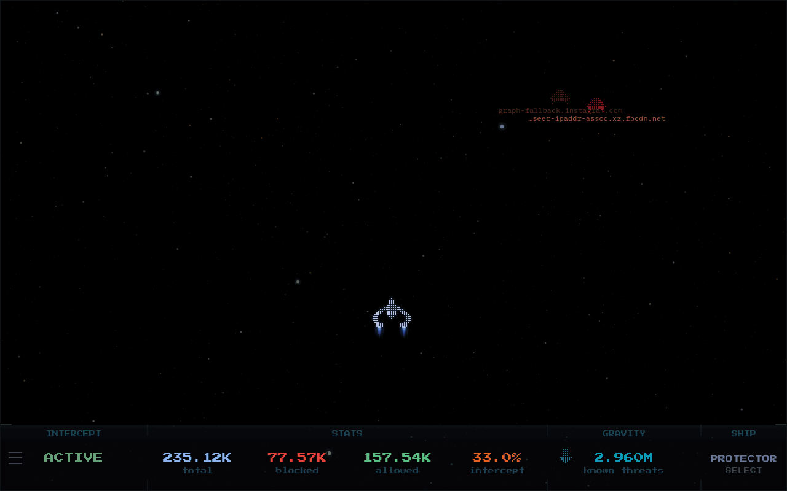

# ph-intercept - AdGuard Home

A DNS dashboard that runs as a standalone Docker container alongside your AdGuard Home instance. Streams live DNS query events from the AdGuard Home API and renders them as pixel-art friendlies and enemies. Blocked queries are destroyed by the ship, allowed queries fly through. Toggle protection, set timed blocks, trigger filter list updates, and switch ships from the HUD.

Designed to be dropped in alongside an existing AdGuard Home setup with no extra dependencies.



---

## Quick Start

**1.** Have your AdGuard Home **username** and **password** ready (the credentials you use to log in to the AdGuard Home web interface).

- **CLI users:** Create a `.env` file in the same directory as your `compose.yaml`:

  ```env
  ADGUARD_PASSWORD=your_adguard_password
  ```

- **Portainer users:** Skip the `.env` file. Add `ADGUARD_PASSWORD` as an environment variable directly in the Portainer stack config.

**2.** Create a `compose.yaml` (copy the example below or grab [`compose.yaml`](compose.yaml) from the repo) and update `ADGUARD_URL` and `ADGUARD_USERNAME` to match your setup:

```yaml
services:
  ph-intercept:
    image: ghcr.io/m00grin/ph-intercept:latest
    hostname: ph-intercept
    container_name: ph-intercept
    restart: unless-stopped
    deploy:
      resources:
        limits:
          memory: 128m
          cpus: "1"
          pids: 20

    environment:
      PROVIDER: adguard

      # REQUIRED: AdGuard Home control API endpoint
      # Example: "http://192.168.1.2:3000/control"
      ADGUARD_URL: "http://CHANGE.ME:PORT/control"

      # REQUIRED: AdGuard Home username or email for login.
      ADGUARD_USERNAME: "CHANGE.ME"

      # CLI users: Create a .env file in the same dir as this compose file with:
      #  ADGUARD_PASSWORD=your_adguard_password
      # Portainer Web users: Add the environment variable: ADGUARD_PASSWORD=your_adguard_password
      ADGUARD_PASSWORD: ${ADGUARD_PASSWORD}

      # Optional: where ESC navigates to (like your homelab dashboard or homepage)
      # Accepts http://, https://, protocol-relative (//), relative paths, and custom app schemes
      # Leave blank ("") to disable ESC entirely
      RETURN_URL: ""

      # Background. These set the DEFAULT; each user can also switch the background live
      # from the in-app settings menu, and their choice is remembered per-browser.
      # Style: starfield | nebula | outrun | dark
      BG_MODE: starfield

      # Sky region shown for the starfield:
      #   summer_triangle | orion | scorpius | southern_cross
      SKY_PRESET: summer_triangle

      # Optional custom background image: a URL, or /bg/your-filename.jpg (mounted volume).
      # When set, it becomes the default and enables the in-app "CUSTOM" option so it can be
      # picked any time. Leave blank to disable it (CUSTOM shows greyed out in the menu).
      BG_IMAGE: ""

      # SSL certificate verification. Set to "false" if AdGuard uses HTTPS
      #  with a self-signed certificate. Leave as "true" for HTTP or valid HTTPS.
      ADGUARD_VERIFY_SSL: "true"

      # Optional: comma-separated regex patterns. Matching domains spawn no ships. Case-insensitive.
      # ADGUARD_IGNORE_DOMAINS: .*\.local$,.*\.internal$

      # 2-player local mode: set all three to enable a second AdGuard ship on the right half
      # ADGUARD2_URL: "http://192.168.1.3:3000/control"
      # ADGUARD2_USERNAME: "CHANGE.ME"
      # ADGUARD2_PASSWORD: ${ADGUARD2_PASSWORD}
      # ADGUARD2_VERIFY_SSL: "true"

    volumes:
      # Portainer Web users: This will resolve to /data/compose/<stack-id>/bg/
      - ./bg:/app/static/bg
      # Persists 2-player mode state across container restarts
      - data:/app/data

    cap_drop:
      - ALL

    security_opt:
      - "no-new-privileges:true"

    read_only: true

    logging:
      driver: "json-file"
      options:
        max-size: "10m"
        max-file: "3"

    ports:
      # Host port : container port. Change the left side if 4663 is taken
      - "4663:4653"

    # Optional: point DNS at your AdGuard Home instance
    # dns:
    #   - your.dns.dockernet.ip

    # Optional: only needed if you use static IPs on a custom Docker network
    # Uncomment both networks blocks if you need this
    # networks:
    #   intercept_net:
    #     ipv4_address: this.container.dockernet.ip

# networks:
#   intercept_net:
#     external: true

volumes:
  data:
```

**3.** Start the container:

```bash
docker compose up -d
```

Open `http://your-host:4663`.

---

## Image Tags

| Tag | What it is |
|-----|------------|
| `:latest` | Latest stable release. |
| `:X.Y.Z` | Pinned release (e.g. `1.5.6`). |
| `:develop` | Built automatically on every push to the `develop` branch. May be unstable. Good for trying out what I'm working on. |

---

## Portainer Note for BG

- Drop image files into `/data/compose/<stack-id>/bg/` on the Portainer host (where the `./bg` bind mount resolves).

## Gameplay, ship, HUD, and background

The entities, ship roster, HUD, and background modes are shared across all providers. See the [main README](../README.md#entities) for the full walkthrough of entity tiers, the seven selectable ships, the four HUD panels, and the starfield / nebula / outrun / dark backgrounds.

With AdGuard Home, the HUD differs in three places:

- **INTERCEPT:** shows protection status. The timed-disable menu offers 30 sec, 1 min, 10 min, 1 hr, and Tomorrow, plus a full disable.
- **FILTER** (in place of GRAVITY): total rules across all active filter lists. The arrow triggers a filter list refresh and confirms when done.
- **Settings:** the provider link opens the AdGuard Home web interface.

---

## Configuration

All configuration is via environment variables in `compose.yaml`.

> **Upgrading?** Pulling the latest `compose.yaml` is recommended so you have all current environment variables on hand. Anything you don't set falls back to a sensible default, so an older compose keeps working, you just might be missing newer options.

### Required

| Variable | Description |
|----------|-------------|
| `ADGUARD_URL` | AdGuard Home control API base URL, e.g. `http://192.168.1.x:3000/control` |
| `ADGUARD_USERNAME` | AdGuard Home username or email address. |
| `ADGUARD_PASSWORD` | AdGuard Home password. CLI: set in a `.env` file. Portainer: add as an environment variable in the stack. |

### Optional

| Variable | Default | Description |
|----------|---------|-------------|
| `ADGUARD_VERIFY_SSL` | `true` | Set to `false` if AdGuard Home uses HTTPS with a self-signed certificate. |
| `ADGUARD_IGNORE_DOMAINS` | _(unset)_ | Comma-separated regex patterns. Domains that match spawn no ships. Case-insensitive; escape literal dots (`\.local$`). Example: `.*\.local$,.*\.internal$` |
| `RETURN_URL` | `""` | URL that ESC navigates to. Accepts `http://`, `https://`, protocol-relative (`//`), relative paths, and custom app schemes. Leave blank to disable ESC. |
| `BG_MODE` | `starfield` | Default background: `starfield` · `nebula` · `outrun` · `dark`. Switchable live in-app. |
| `SKY_PRESET` | `summer_triangle` | Default sky region: `summer_triangle` · `orion` · `scorpius` · `southern_cross`. Switchable live in-app. |
| `BG_IMAGE` | `""` | Custom image URL or `/bg/filename.jpg`. When set, it's the default and enables the in-app `CUSTOM` option; blank leaves `CUSTOM` disabled. |
| `ADGUARD2_URL` | _(unset)_ | Second AdGuard Home control API base URL. Setting a valid URL activates local 2-player split-screen mode. See below. |
| `ADGUARD2_USERNAME` | `""` | Username or email for the second AdGuard Home instance. |
| `ADGUARD2_PASSWORD` | `""` | Password for the second AdGuard Home instance. |
| `ADGUARD2_VERIFY_SSL` | `true` | Set to `false` if the second AdGuard Home uses HTTPS with a self-signed certificate. |

---

## Local 2-Player Mode

Two AdGuard Home instances can run side by side in split-screen. P1's ship occupies the left half of the canvas, P2's ship the right. Each instance streams its own query events independently.

Add the second AdGuard Home to your `compose.yaml` environment block:

```yaml
ADGUARD2_URL: "http://192.168.1.3:3000/control"
ADGUARD2_USERNAME: "admin"
ADGUARD2_PASSWORD: ${ADGUARD2_PASSWORD}
```

And add the password to your `.env` file:

```env
ADGUARD2_PASSWORD=your_second_adguard_password
```

Setting a valid `ADGUARD2_URL` is all that is required to activate split-screen mode; toggle it on from the in-game 2-player panel. The second instance mirrors the primary provider, so AdGuard pairs with AdGuard (a Pi-hole second instance uses `PIHOLE2_*` instead).

---

## Requirements

- AdGuard Home v0.107.28 or newer
- Docker with Compose
- Network route from the container to your AdGuard Home instance
- **Architecture:** `linux/amd64` · `linux/arm64` · `linux/arm/v7` · `linux/arm/v6` · `linux/386` · `linux/riscv64` · `linux/ppc64le`

The container listens on port 4653 internally, mapped to host port 4663 by default. The compose file includes an optional static IP block for existing Docker networks.

Curious what everyone runs it on? I'm asking in a [quick poll](https://github.com/m00grin/ph-intercept/discussions/52) instead of collecting any data.

---

## Troubleshooting

If something's off, check the logs first:

```bash
docker logs ph-intercept 2>&1 | grep -v '^INFO:'
```

On a healthy setup that prints nothing. Otherwise ph-intercept logs one line when a problem starts, and one line when it clears:

| Log line | What to check |
|----------|---------------|
| `AdGuard: could not reach http://... Check ADGUARD_URL` | The URL and port, and that the container can reach AdGuard Home over the network. |
| `AdGuard: login rejected (HTTP 401). Check ADGUARD_USERNAME and ADGUARD_PASSWORD` | The username (or email) and password you log in to AdGuard Home with. |
| `AdGuard: unexpected HTTP 404 from ... Check ADGUARD_URL points at the control API (ends in /control)` | `ADGUARD_URL` must end in `/control`. |
| `AdGuard query log: ...` | Same checks as the lines above, for the query log endpoint. |
| `PROVIDER='...' is not recognised ...` | `PROVIDER` must be `adguard` here. |

In 2-player mode the second instance logs the same lines as `AdGuard 2`, pointing at the `ADGUARD2_*` variables.

---

## Privacy

ph-intercept only talks to your own AdGuard Home instance(s). It never phones home, has no analytics, and collects nothing. Your display settings (ship, background, toggles) are saved in your browser's local storage and never leave it. Requests from other websites to the blocking controls are refused, so a page you visit can't toggle your DNS server through ph-intercept.
