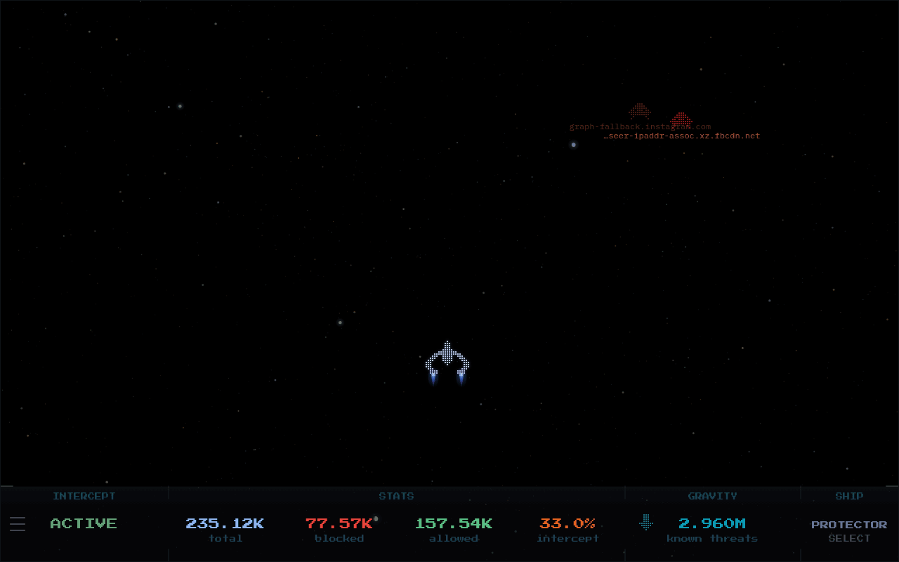

# ph-intercept - AdGuard Home

A DNS dashboard that runs as a standalone Docker container alongside your AdGuard Home instance. Streams live DNS query events from the AdGuard Home API and renders them as pixel-art friendlies and enemies. Blocked queries are destroyed by the ship, allowed queries fly through. Toggle protection, set timed blocks, trigger filter list updates, and switch ships from the HUD.

ph-intercept uses one compose for every ad-blocker it supports. This page is that compose with the AdGuard Home lines filled in, plus what's specific to AdGuard Home. Everything else is in the [main README](../README.md).



---

## Quick Start

**1.** Have your AdGuard Home **username** and **password** ready (the ones you use to log in to the AdGuard Home web interface).

- **CLI users:** Create a `.env` file in the same directory as your `compose.yaml`:

  ```env
  BLOCKER_PASSWORD=your_adguard_password
  ```

- **Portainer users:** Skip the `.env` file. Add `BLOCKER_PASSWORD` as an environment variable directly in the Portainer stack config.

**2.** Create a `compose.yaml` (copy the example below or grab [`compose.yaml`](compose.yaml) from the repo) and set `BLOCKER_URL` and `BLOCKER_USERNAME`:

```yaml
services:
  ph-intercept:
    image: ghcr.io/m00grin/ph-intercept:latest
    hostname: ph-intercept
    container_name: ph-intercept
    restart: unless-stopped
    deploy:
      resources:
        limits:
          memory: 128m
          cpus: "1"
          pids: 20

    environment:
      # REQUIRED: the address you open in a browser to manage AdGuard Home.
      # Example: "http://192.168.1.2:3000"
      BLOCKER_URL: "http://CHANGE.ME:3000"

      # REQUIRED: the username you log in to AdGuard Home with
      BLOCKER_USERNAME: "CHANGE.ME"

      # CLI users: Create a .env file in the same dir as this compose file with:
      #  BLOCKER_PASSWORD=your_adguard_password
      # Portainer Web users: Add the environment variable: BLOCKER_PASSWORD=your_adguard_password
      BLOCKER_PASSWORD: ${BLOCKER_PASSWORD}

      # Optional: where ESC navigates to (like your homelab dashboard or homepage)
      # Accepts http://, https://, protocol-relative (//), relative paths, and custom app schemes
      # Leave blank ("") to disable ESC entirely
      RETURN_URL: ""

      # Background. These set the DEFAULT; each user can also switch the background live
      # from the in-app settings menu, and their choice is remembered per-browser.
      # Style: starfield | nebula | outrun | dark
      BG_MODE: starfield

      # Sky region shown for the starfield:
      #   summer_triangle | orion | scorpius | southern_cross
      SKY_PRESET: summer_triangle

      # Optional custom background image: a URL, or /bg/your-filename.jpg (mounted volume).
      # When set, it becomes the default and enables the in-app "CUSTOM" option so it can be
      # picked any time. Leave blank to disable it (CUSTOM shows greyed out in the menu).
      BG_IMAGE: ""

      # SSL certificate verification. Set to "false" if AdGuard Home uses HTTPS
      #  with a self-signed certificate. Leave as "true" for HTTP or valid HTTPS.
      BLOCKER_VERIFY_SSL: "true"

      # Optional: comma-separated regex patterns. Matching domains spawn no ships. Case-insensitive.
      # IGNORE_DOMAINS: .*\.local$,.*\.internal$

      # Optional: "true" makes the page view-only. The server refuses the blocking
      # toggle, filter update and 2-player mode switch; the HUD controls go inert.
      # READ_ONLY: "true"

      # Optional: "true" drops the client name/IP from every query on the server,
      # so it never reaches the browser. Also hides the in-app CLIENT toggle.
      # HIDE_CLIENT: "true"

      # Optional: comma-separated regex patterns matched against the client name or IP.
      # Queries from matching clients spawn no ships. Case-insensitive.
      # IGNORE_CLIENTS: ^uptime-kuma$,^192\.168\.1\.99$

      # Optional: "true" replaces every domain with an opaque per-start token on the
      # server. Repeat queries still group; domain labels and the DOMAIN toggle go away.
      # HIDE_DOMAIN: "true"

      # Optional: how much goes in the container log: info (default), debug, warning, or error
      # LOG_LEVEL: info

      # 2-player local mode: a second ad-blocker, any of the four, for a second ship on
      # the right half. Same settings as above with BLOCKER2_.
      # BLOCKER2_URL: "http://192.168.1.3:3000"
      # BLOCKER2_USERNAME: "admin"
      # BLOCKER2_PASSWORD: ${BLOCKER2_PASSWORD}

    volumes:
      # Portainer Web users: This will resolve to /data/compose/<stack-id>/bg/
      - ./bg:/app/static/bg
      # Persists 2-player mode state across container restarts
      - data:/app/data

    cap_drop:
      - ALL

    security_opt:
      - "no-new-privileges:true"

    read_only: true

    ports:
      # Host port : container port. Change the left side if 4663 is taken
      - "4663:4653"

    # Optional: point DNS at your AdGuard Home (if used for DNS resolution) or resolver directly (like Unbound)
    # dns:
    #   - your.dns.dockernet.ip

    # Optional: only needed if you use static IPs on a custom Docker network
    # Uncomment both networks blocks if you need this
    # networks:
    #   intercept_net:
    #     ipv4_address: this.container.dockernet.ip

# networks:
#   intercept_net:
#     external: true

volumes:
  data:
```

**3.** Start the container:

```bash
docker compose up -d
```

Open `http://your-host:4663`.

---

## AdGuard Home notes

- **Address:** `BLOCKER_URL` is the address of the AdGuard Home web interface, the one you log in at, for example `http://192.168.1.2:3000` or `http://192.168.1.2` if it runs on port 80. A pasted `/#/dashboard` on the end is fine.
- **Versions:** AdGuard Home 0.107.52 or newer, including 1.0.
- **Login:** ph-intercept logs in once and reuses the session, so it doesn't make AdGuard Home check your password on every request.
- **HUD:** **BLOCKLIST** shows the number of rules in your blocklists, and the arrow runs **Check for updates**. The timed-disable menu offers AdGuard Home's own choices, including until tomorrow.
- **2-player:** the second side can be another AdGuard Home or any other supported server. See [Local 2-Player Mode](../README.md#local-2-player-mode).
- **Settings from before 1.6** (`PROVIDER: adguard`, `ADGUARD_URL` ending in `/control`, `ADGUARD_USERNAME`, `ADGUARD_PASSWORD`) still work exactly as before. See [Older settings](../README.md#older-settings).

Configuration, troubleshooting, and privacy: see the [main README](../README.md#configuration).
